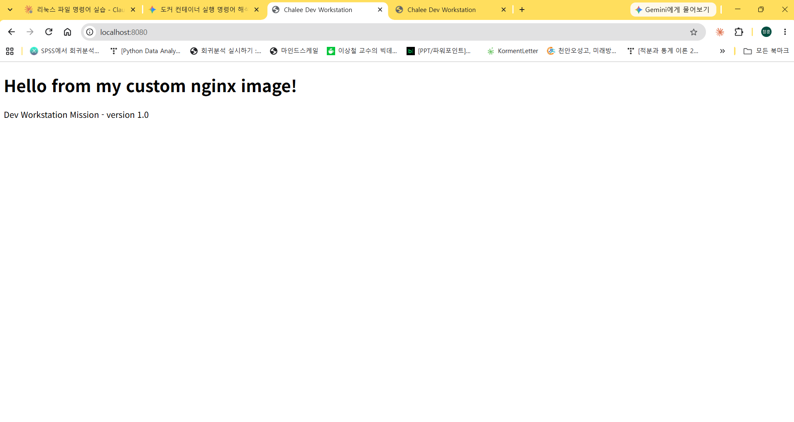
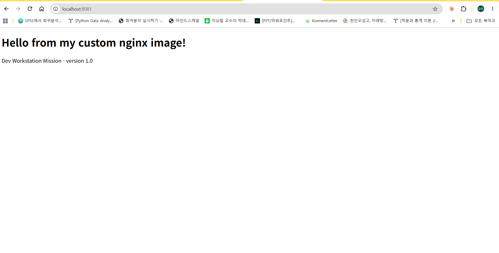
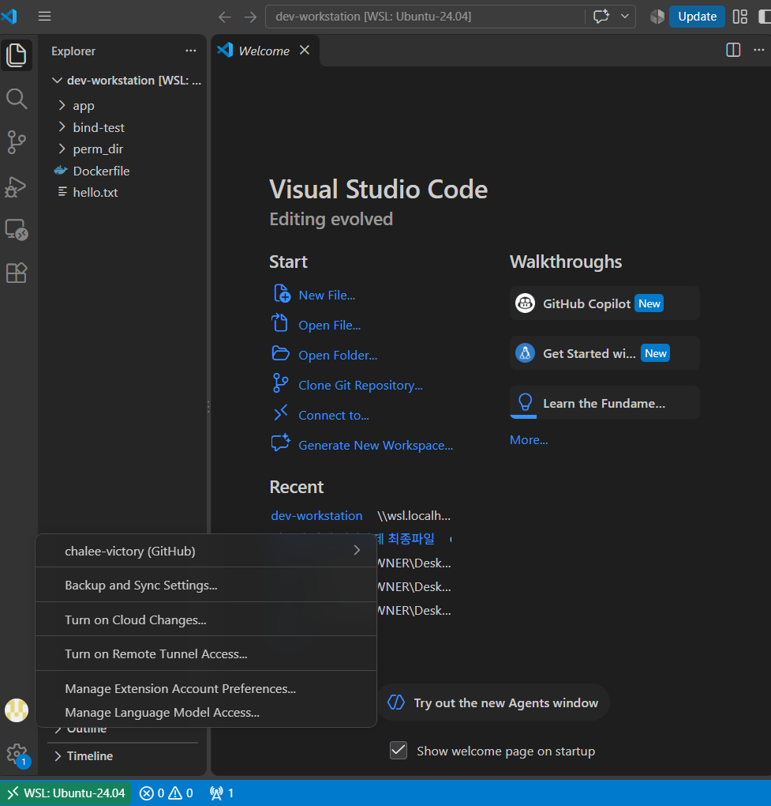
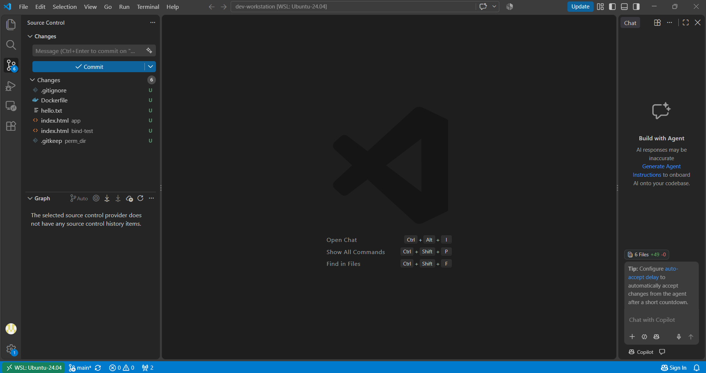

# 개발자 작업실(Dev Workstation) 구축 미션

> 터미널 · Docker · Git/GitHub를 직접 세팅하고, 실행 결과(로그·접속·데이터 유지)로 검증한 기록입니다.

- 저장소: https://github.com/chalee-victory/dev-workstation
- 작성자: chalee-victory

## 목차
1. 프로젝트 개요
2. 실행 환경
3. 수행 체크리스트
4. 검증 방법 및 증거 위치
5. 수행 로그 (4-1 ~ 4-20)
6. 트러블슈팅
7. 보안 및 개인정보 보호
8. 저장소 구조

---

## 1) 프로젝트 개요
- **목표:** 누구나 같은 방식으로 실행·배포·디버깅할 수 있는 재현 가능한 개발 환경 구성
- **범위:** 리눅스 CLI 기본 조작과 권한 → Docker 설치·운영 → Dockerfile 커스텀 이미지 → 포트 매핑 → 바인드 마운트·볼륨 → Git 설정 → VSCode·GitHub 연동
- **핵심 원칙:** 이미지와 컨테이너의 분리, 격리된 실행 환경, 포트·스토리지 연결 방식을 직접 실행하고 결과로 확인

## 2) 실행 환경
| 항목 | 내용 |
|---|---|
| Host OS | Windows (WSL2) |
| Linux | Ubuntu 24.04 LTS (WSL2) |
| Shell | bash |
| Terminal | Windows Terminal / Ubuntu |
| Docker | Docker Engine 29.1.3 (Ubuntu `docker.io` 패키지, WSL 내부 설치) / Buildx 0.30.1 / Compose 2.40.3 |
| Kernel | 6.18.54.1-microsoft-standard-WSL2 |
| Git | 2.43.0 |
| Editor | Visual Studio Code 1.143.1 + WSL 확장(Microsoft) |
| 작업 경로 | `~/codyssey/dev-workstation` (= `/home/chalee/codyssey/dev-workstation`) |

> **재현 시 주의**
> - 사용자 이름(`chalee`)과 홈 경로는 환경마다 다릅니다. `~`를 쓰면 각자의 홈으로 대체됩니다.
> - WSL에서는 `/mnt/c/...`(Windows 드라이브) 대신 리눅스 홈에서 작업해야 속도와 권한이 정상 동작합니다.
> - Docker Desktop을 쓰는 환경(또는 sudo가 제한된 환경에서 OrbStack 등)에서도 `docker` 명령은 동일하게 사용할 수 있습니다. 이 기록은 WSL Ubuntu에 Docker Engine을 직접 설치한 경우입니다.
> - VSCode는 반드시 WSL 터미널에서 `code .`로 열어야 WSL 쪽 Git과 설정이 적용됩니다 (6) TS-4 참고).

**환경별 경로·주의사항 요약**
| 구분 | WSL(Ubuntu) 쪽 | Windows 쪽 | 주의 |
|---|---|---|---|
| 작업 폴더 | `/home/chalee/codyssey/dev-workstation` | `\\wsl.localhost\Ubuntu-24.04\home\chalee\codyssey\dev-workstation` | 작업·Docker 마운트는 WSL 경로에서 |
| Windows 파일 | `/mnt/c/Users/OWNER/Desktop/...` | `C:\Users\OWNER\Desktop\...` | `/mnt/c`에서 복사한 파일은 `rwxrwxrwx`로 보임 → 커밋 전 `chmod 644` (5장 4-20) |
| 바인드 마운트 | `-v "$(pwd)/bind-test":...` 처럼 **절대 경로** | 사용하지 않음 | `/`로 시작하지 않으면 볼륨 이름으로 해석됨 (4-13) |
| 브라우저 접속 | `curl http://localhost:8080` | 브라우저 `http://localhost:8080` | WSL2가 localhost를 Windows와 공유 (4-12) |
| VSCode | WSL 터미널에서 `code .` | 작업 표시줄 아이콘으로 열면 Windows 모드 | 왼쪽 아래 `WSL: Ubuntu-24.04` 확인 (TS-4) |
| GitHub 인증 | VSCode(WSL) 통합 터미널에서 `git push` | 브라우저 OAuth 승인 | 일반 터미널은 계정 비밀번호 불가 (TS-7) |

## 3) 수행 체크리스트
- [x] 터미널 기본 조작 및 폴더 구성 (4-1 ~ 4-3)
- [x] 권한 변경 실습 (파일 1, 디렉토리 1) + 권한 차단 확인 (4-4, 4-5)
- [x] Docker 설치/점검 (`docker --version`, `docker info`) (4-6)
- [x] hello-world 실행 / ubuntu 컨테이너 진입 (attach vs exec) (4-7 ~ 4-9)
- [x] Docker 운영 명령 (images, ps -a, logs, stats) (4-10)
- [x] Dockerfile 커스텀 이미지 빌드/실행 (4-11)
- [x] 포트 매핑 접속 (2회) + 브라우저 캡처 (4-12)
- [x] 바인드 마운트 반영 (변경 전/후) (4-13)
- [x] 볼륨 영속성 (삭제 전/후 + 대조군) (4-14)
- [x] Git 사용자 정보·기본 브랜치 설정 (4-15)
- [x] VSCode + WSL 연결 + GitHub 로그인 (4-16)
- [x] 로컬 저장소 생성 + `.gitignore` + GitHub 원격 저장소 연결 (4-17)
- [x] 포트 충돌 재현 → 점유 프로세스 진단 → 포트 해제 (4-18)
- [x] 볼륨 백업 → 새 볼륨에 복원 (4-19)
- [x] 첫 커밋 및 GitHub push, 커밋 이력 링크 (4-20)
- [x] 트러블슈팅 2건 이상 (6장)

## 4) 검증 방법 및 증거 위치
| 항목 | 확인 명령 / 방법 | 확인한 내용 | 증거 위치 |
|---|---|---|---|
| 터미널 조작 | `pwd`, `ls -la`, `mkdir`, `cp`, `mv`, `rm`, `cat`, `touch` | 생성·복사·이동·이름변경·삭제 결과 | 5장 4-1 ~ 4-3 |
| 권한 | `ls -l`, `ls -ld`, `chmod` | 644→600, 755→700 변경 전/후, 권한 제거 시 `Permission denied` | 5장 4-4, 4-5 |
| Docker 설치 | `docker --version`, `docker info`, `systemctl is-active docker` | 버전 29.1.3, Server 정보 출력(데몬 동작) | 5장 4-6 |
| 컨테이너 실행 | `docker run hello-world`, `docker run -it ubuntu bash` | `Hello from Docker!`, 컨테이너 내부 `ls`/`echo` | 5장 4-7, 4-8 |
| attach / exec | `docker exec -it`, `docker attach`, `docker ps` | exec 후 exit → 유지, attach 후 exit → 종료 | 5장 4-9 |
| 운영 명령 | `docker images`, `docker ps -a`, `docker logs`, `docker stats` | 이미지 목록, 상태, 로그, CPU/메모리 | 5장 4-10 |
| 커스텀 이미지 | `docker build`, `docker image inspect`, `docker ps` (healthy) | LABEL·ENV 반영, HEALTHCHECK 동작 | 5장 4-11 |
| 포트 매핑 | `docker run -p 8080:80`, `-p 8081:80`, `curl`, 브라우저 | 두 포트에서 같은 페이지 응답 | 5장 4-12, [`port-8080.png`](docs/images/port-8080.png), [`port-8081.png`](docs/images/port-8081.png) |
| 바인드 마운트 | `docker run -v "$(pwd)/bind-test":...`, `curl` | 호스트 수정이 재시작 없이 즉시 반영 | 5장 4-13 |
| 볼륨 영속성 | `docker volume create`, `docker rm -f`, 새 컨테이너에서 `cat` | 볼륨 데이터 유지 / 볼륨 없는 대조군은 소멸 | 5장 4-14 |
| Git 설정 | `git config --list` | user.name, user.email(마스킹), init.defaultbranch=main | 5장 4-15 |
| VSCode·GitHub 로그인 | `code --version`, `code .`, VSCode 계정 메뉴 | `WSL: Ubuntu-24.04`, `chalee-victory (GitHub)` | 5장 4-16, [`vscode-github-login.png`](docs/images/vscode-github-login.png) |
| 저장소 연동 | `git init`, `git status`, `git check-ignore -v`, `git remote -v` | main 브랜치, `.gitignore` 차단, origin 등록 | 5장 4-17, [`vscode-source-control.png`](docs/images/vscode-source-control.png) |
| 포트 충돌 진단·해제 | `sudo ss -ltnp`, `docker ps --filter publish=8080`, `docker stop`, `docker inspect`, `docker port` | `port is already allocated` → 점유자 확인 → 해제 후 재실행 성공 | 5장 4-18, 6장 TS-6 |
| 볼륨 백업·복원 | `docker run --rm ... tar czf` / `tar xzf`, `docker volume create` | 백업 파일 생성, 빈 새 볼륨에 복원 후 같은 데이터 확인 | 5장 4-19 |
| GitHub push | `git commit`, `git push -u origin main`, `git log` | `* [new branch] main -> main`, 커밋 `39c85f7` | 5장 4-20, [커밋 이력](https://github.com/chalee-victory/dev-workstation/commits/main) |

## 5) 수행 로그

### 4-1. 작업 폴더 생성 및 이동
```bash
chalee@LG:~$ pwd
/home/chalee
chalee@LG:~$ mkdir -p ~/codyssey/dev-workstation
chalee@LG:~$ cd ~/codyssey/dev-workstation
chalee@LG:~/codyssey/dev-workstation$ pwd
/home/chalee/codyssey/dev-workstation
chalee@LG:~/codyssey/dev-workstation$ ls -la
total 8
drwxr-xr-x 2 chalee chalee 4096 Nov  6 15:25 .
drwxr-xr-x 3 chalee chalee 4096 Nov  6 15:25 ..
```

**절대 경로 vs 상대 경로**
```bash
chalee@LG:~$ cd /home          # 절대 경로: / 부터 시작
chalee@LG:/home$ cd chalee     # 상대 경로: 현재 위치(/home) 기준
chalee@LG:~$ pwd
/home/chalee
chalee@LG:~$ cd ..             # 상대 경로: 한 단계 위
chalee@LG:/home$ pwd
/home
```
- 절대 경로: 루트(`/`)부터 쓰는 전체 주소. 현재 위치와 관계없이 항상 같은 곳을 가리킴
- 상대 경로: 현재 위치 기준 주소. `.` = 현재 폴더, `..` = 상위 폴더

### 4-2. 빈 파일 생성 / 내용 쓰기 / 내용 확인
```bash
chalee@LG:~/codyssey/dev-workstation$ touch empty.txt
chalee@LG:~/codyssey/dev-workstation$ echo "Hello Codyssey" > hello.txt
chalee@LG:~/codyssey/dev-workstation$ echo "second line" >> hello.txt
chalee@LG:~/codyssey/dev-workstation$ cat hello.txt
Hello Codyssey
second line
chalee@LG:~/codyssey/dev-workstation$ cat empty.txt
chalee@LG:~/codyssey/dev-workstation$ ls -la
total 12
drwxr-xr-x 2 chalee chalee 4096 Nov  6 15:46 .
drwxr-xr-x 3 chalee chalee 4096 Nov  6 15:25 ..
-rw-r--r-- 1 chalee chalee    0 Nov  6 15:45 empty.txt
-rw-r--r-- 1 chalee chalee   27 Nov  6 15:49 hello.txt
```
- `touch`: 빈 파일 생성 (크기 0)
- `>`: 덮어쓰기, `>>`: 이어쓰기 → hello.txt 크기가 15 → 27로 증가

### 4-3. 복사 / 이동 / 이름변경 / 삭제
```bash
chalee@LG:~/codyssey/dev-workstation$ cp hello.txt hello_copy.txt   # 복사
chalee@LG:~/codyssey/dev-workstation$ mkdir backup
chalee@LG:~/codyssey/dev-workstation$ mv hello_copy.txt backup/     # 이동
chalee@LG:~/codyssey/dev-workstation$ mv empty.txt blank.txt        # 이름변경
chalee@LG:~/codyssey/dev-workstation$ ls -la
total 16
drwxr-xr-x 3 chalee chalee 4096 Nov  6 15:56 .
drwxr-xr-x 3 chalee chalee 4096 Nov  6 15:25 ..
drwxr-xr-x 2 chalee chalee 4096 Nov  6 15:55 backup
-rw-r--r-- 1 chalee chalee    0 Nov  6 15:45 blank.txt
-rw-r--r-- 1 chalee chalee   27 Nov  6 15:49 hello.txt
chalee@LG:~/codyssey/dev-workstation$ ls -la backup
total 12
drwxr-xr-x 2 chalee chalee 4096 Nov  6 15:55 .
drwxr-xr-x 3 chalee chalee 4096 Nov  6 15:56 ..
-rw-r--r-- 1 chalee chalee   27 Nov  6 15:54 hello_copy.txt
chalee@LG:~/codyssey/dev-workstation$ rm blank.txt                  # 파일 삭제
chalee@LG:~/codyssey/dev-workstation$ rm -r backup                  # 폴더 삭제
chalee@LG:~/codyssey/dev-workstation$ ls -la
total 12
drwxr-xr-x 2 chalee chalee 4096 Nov  6 15:57 .
drwxr-xr-x 3 chalee chalee 4096 Nov  6 15:25 ..
-rw-r--r-- 1 chalee chalee   27 Nov  6 15:49 hello.txt
```
- `cp`는 새 파일을 만들어 복사 시각(15:54)이 기록되고, `mv` 이름변경은 원래 생성 시각(15:45)이 유지됨

### 4-4. 권한 실습 (파일 1개 + 디렉토리 1개)
```bash
chalee@LG:~/codyssey/dev-workstation$ mkdir perm_dir

# 변경 전
chalee@LG:~/codyssey/dev-workstation$ ls -l hello.txt
-rw-r--r-- 1 chalee chalee 27 Nov  6 15:49 hello.txt
chalee@LG:~/codyssey/dev-workstation$ ls -ld perm_dir
drwxr-xr-x 2 chalee chalee 4096 Nov  6 16:20 perm_dir

# 권한 변경
chalee@LG:~/codyssey/dev-workstation$ chmod 600 hello.txt
chalee@LG:~/codyssey/dev-workstation$ chmod 700 perm_dir

# 변경 후
chalee@LG:~/codyssey/dev-workstation$ ls -l hello.txt
-rw------- 1 chalee chalee 27 Nov  6 15:49 hello.txt
chalee@LG:~/codyssey/dev-workstation$ ls -ld perm_dir
drwx------ 2 chalee chalee 4096 Nov  6 16:20 perm_dir
```

| 대상 | 변경 전 | 변경 후 |
|---|---|---|
| hello.txt | 644 (rw-r--r--) | 600 (rw-------) |
| perm_dir | 755 (rwxr-xr-x) | 700 (rwx------) |

**권한 숫자 해석 규칙**
- r=4, w=2, x=1을 더해 소유자/그룹/기타 3자리로 표기
- 644 = rw-(6) r--(4) r--(4): 일반 파일 기본값
- 755 = rwx(7) r-x(5) r-x(5): 디렉토리·실행 파일 기본값
- 디렉토리의 x는 "진입(cd) 가능"을 의미

### 4-5. 권한이 실제로 접근을 막는지 확인 (소유자 권한 제거 → 복구)
```bash
# 디렉토리에서 x(진입) 제거
chalee@LG:~/codyssey/dev-workstation$ chmod 600 perm_dir
chalee@LG:~/codyssey/dev-workstation$ ls -ld perm_dir
drw------- 2 chalee chalee 4096 Nov  6 16:20 perm_dir
chalee@LG:~/codyssey/dev-workstation$ cd perm_dir
-bash: cd: perm_dir: Permission denied

# 파일에서 r(읽기) 제거
chalee@LG:~/codyssey/dev-workstation$ chmod 200 hello.txt
chalee@LG:~/codyssey/dev-workstation$ ls -la hello.txt
--w------- 1 chalee chalee 27 Nov  6 15:49 hello.txt
chalee@LG:~/codyssey/dev-workstation$ cat hello.txt
cat: hello.txt: Permission denied

# 원래 권한으로 복구
chalee@LG:~/codyssey/dev-workstation$ chmod 755 perm_dir
chalee@LG:~/codyssey/dev-workstation$ chmod 644 hello.txt
chalee@LG:~/codyssey/dev-workstation$ ls -l hello.txt
-rw-r--r-- 1 chalee chalee 27 Nov  6 15:49 hello.txt
chalee@LG:~/codyssey/dev-workstation$ ls -ld perm_dir
drwxr-xr-x 2 chalee chalee 4096 Nov  6 16:20 perm_dir
```
- 디렉토리에 r/w가 있어도 x가 없으면 들어갈 수 없음 → 디렉토리의 x = 진입 권한
- 파일 소유자라도 r이 없으면 읽을 수 없음 → 권한은 소유자에게도 그대로 적용됨

### 4-6. Docker 설치 및 점검

**설치 방식:** Docker Desktop 대신 WSL Ubuntu 안에 Docker Engine을 `apt`로 직접 설치 (모든 과정을 CLI로 수행·기록하기 위함)

```bash
chalee@LG:~$ docker --version
docker: command not found          # 설치 전

chalee@LG:~$ sudo apt update
chalee@LG:~$ sudo apt install -y docker.io docker-buildx docker-compose-v2
...
Created symlink /etc/systemd/system/multi-user.target.wants/docker.service → /usr/lib/systemd/system/docker.service.
Created symlink /etc/systemd/system/sockets.target.wants/docker.socket → /usr/lib/systemd/system/docker.socket.
...
chalee@LG:~$ docker --version
Docker version 29.1.3, build 29.1.3-0ubuntu3~24.04.2
chalee@LG:~$ systemctl is-active docker
active
```

**sudo 없이 docker를 쓰기 위한 그룹 설정**
```bash
chalee@LG:~$ sudo usermod -aG docker $USER
# 그룹 변경은 재로그인 후 적용 → PowerShell에서 wsl --terminate Ubuntu-24.04 후 Ubuntu 재실행
# (현재 창에서만 즉시 적용하려면 newgrp docker)
```

**데몬 동작 확인 (`docker info` 발췌)**
```bash
chalee@LG:~$ docker info
Client:
 Version:    29.1.3
 Context:    default
 Plugins:
  buildx: Docker Buildx (Docker Inc.)
    Version:  0.30.1
  compose: Docker Compose (Docker Inc.)
    Version:  2.40.3+ds1-0ubuntu1~24.04.1

Server:
 Containers: 0
  Running: 0
  Paused: 0
  Stopped: 0
 Images: 0
 Server Version: 29.1.3
 Storage Driver: overlayfs
 Logging Driver: json-file
 Cgroup Driver: systemd
 Cgroup Version: 2
 Kernel Version: 6.18.54.1-microsoft-standard-WSL2
 Operating System: Ubuntu 24.04.5 LTS
 OSType: linux
 Architecture: x86_64
 CPUs: 18
 Total Memory: 7.623GiB
 Docker Root Dir: /var/lib/docker
...
```
- `Client` = `docker` 명령(리모컨), `Server` = 데몬(실제 엔진). Server 정보가 출력되면 데몬이 정상 동작 중
- `systemctl is-active docker` → `active`: 데몬이 systemd 서비스로 실행 중이며 WSL 시작 시 자동 실행
- 설치 직후라 컨테이너 0개, 이미지 0개

### 4-7. hello-world 실행
```bash
chalee@LG:~$ docker run hello-world
Unable to find image 'hello-world:latest' locally
latest: Pulling from library/hello-world
4f55086f7dd0: Pull complete
d5e71e642bf5: Download complete
Digest: sha256:c567b231f65614688711a75f31518a064258a51d442117a3e771a3a8fdba78ef
Status: Downloaded newer image for hello-world:latest

Hello from Docker!
This message shows that your installation appears to be working correctly.
...
chalee@LG:~$ docker images
IMAGE                ID             DISK USAGE   CONTENT SIZE   EXTRA
hello-world:latest   c567b231f656       25.9kB         9.49kB    U
chalee@LG:~$ docker ps
CONTAINER ID   IMAGE     COMMAND   CREATED   STATUS    PORTS     NAMES
chalee@LG:~$ docker ps -a
CONTAINER ID   IMAGE         COMMAND    CREATED          STATUS                      PORTS     NAMES
57c2a9ae274e   hello-world   "/hello"   42 seconds ago   Exited (0) 41 seconds ago             happy_wiles
```
- 로컬에 이미지가 없으면 Docker Hub에서 자동으로 내려받은 뒤(Pull) 컨테이너를 생성·실행
- hello-world는 메시지 출력 후 프로그램이 끝나므로 컨테이너도 즉시 종료 → `docker ps`(실행 중)에는 없고 `docker ps -a`(전체)에만 `Exited (0)`(정상 종료)로 표시

### 4-8. ubuntu 컨테이너 내부 진입
```bash
chalee@LG:~$ docker run -it --name chalee ubuntu bash
Unable to find image 'ubuntu:latest' locally
latest: Pulling from library/ubuntu
...
Status: Downloaded newer image for ubuntu:latest
root@a7d0037cf1fe:/# whoami
root
root@a7d0037cf1fe:/# pwd
/
root@a7d0037cf1fe:/# ls
bin   dev  home  lib64  mnt  proc  run   srv  tmp  var
boot  etc  lib   media  opt  root  sbin  sys  usr
root@a7d0037cf1fe:/# echo "Hello from container"
Hello from container
root@a7d0037cf1fe:/# cat /etc/os-release
PRETTY_NAME="Ubuntu 26.04.1 LTS"
NAME="Ubuntu"
VERSION_ID="26.04"
...
root@a7d0037cf1fe:/# exit
exit
chalee@LG:~$ docker ps -a
CONTAINER ID   IMAGE         COMMAND    CREATED              STATUS                      PORTS     NAMES
a7d0037cf1fe   ubuntu        "bash"     About a minute ago   Exited (0) 12 seconds ago             chalee
57c2a9ae274e   hello-world   "/hello"   7 minutes ago        Exited (0) 7 minutes ago              happy_wiles
```
- `-it`: 입력(-i) + 터미널(-t) 연결 → 컨테이너 안의 bash와 대화
- 프롬프트가 `root@<컨테이너ID>:/#`로 바뀜 → 별도의 호스트명·사용자(root)·파일시스템을 가진 격리 환경
- **격리 확인:** 호스트는 Ubuntu 24.04인데 컨테이너는 Ubuntu 26.04 → 같은 PC에서 다른 버전의 OS 환경이 독립적으로 실행됨 (커널은 호스트 WSL2 커널을 공유)
- `exit`로 bash가 끝나자 컨테이너도 `Exited` 상태가 됨 → 컨테이너는 메인 프로세스가 살아 있는 동안만 실행됨

### 4-9. attach vs exec 차이 관찰
```bash
chalee@LG:~$ docker start chalee
chalee
chalee@LG:~$ docker ps
CONTAINER ID   IMAGE     COMMAND   CREATED         STATUS         PORTS     NAMES
a7d0037cf1fe   ubuntu    "bash"    6 minutes ago   Up 5 seconds             chalee

# (1) exec: 새 bash를 추가로 실행해 접속
chalee@LG:~$ docker exec -it chalee bash
root@a7d0037cf1fe:/# echo "I came in with exec"
I came in with exec
root@a7d0037cf1fe:/# exit
exit
chalee@LG:~$ docker ps
CONTAINER ID   IMAGE     COMMAND   CREATED         STATUS              PORTS     NAMES
a7d0037cf1fe   ubuntu    "bash"    8 minutes ago   Up About a minute             chalee   # ← 계속 실행 중

# (2) attach: 메인 프로세스(bash)에 직접 접속
chalee@LG:~$ docker attach chalee
root@a7d0037cf1fe:/# echo "I came in with attach"
I came in with attach
root@a7d0037cf1fe:/# exit
exit
chalee@LG:~$ docker ps -a
CONTAINER ID   IMAGE         COMMAND    CREATED          STATUS                      PORTS     NAMES
a7d0037cf1fe   ubuntu        "bash"     9 minutes ago    Exited (0) 11 seconds ago             chalee   # ← 종료됨
57c2a9ae274e   hello-world   "/hello"   14 minutes ago   Exited (0) 14 minutes ago             happy_wiles
```

| | `docker exec -it <컨테이너> bash` | `docker attach <컨테이너>` |
|---|---|---|
| 접속 대상 | 메인과 별개로 **새 프로세스(bash)를 추가 실행** | 컨테이너의 **메인 프로세스**에 직접 연결 |
| `exit` 시 | 추가로 띄운 bash만 종료 → 컨테이너 **유지(Up)** | 메인 프로세스 종료 → 컨테이너 **종료(Exited)** |
| 용도 | 실행 중인 서비스 점검·디버깅 (안전) | 메인 프로세스의 입출력을 직접 볼 때 |

- attach 상태에서 컨테이너를 끄지 않고 빠져나오려면 `Ctrl+P` → `Ctrl+Q` (detach)

### 4-10. Docker 운영 명령 (이미지 / 컨테이너 / 로그 / 리소스)

**이미지 다운로드·목록**
```bash
chalee@LG:~$ docker pull nginx:alpine
alpine: Pulling from library/nginx
881fc932939e: Pull complete
...
Status: Downloaded newer image for nginx:alpine
docker.io/library/nginx:alpine
chalee@LG:~$ docker images
IMAGE                ID             DISK USAGE   CONTENT SIZE   EXTRA
hello-world:latest   c567b231f656       25.9kB         9.49kB    U
nginx:alpine         b2f80f8f8814       94.5MB         27.3MB
ubuntu:latest        6a06111c3b0a        163MB         45.9MB    U
```

**백그라운드 실행·목록**
```bash
chalee@LG:~$ docker run -d --name ops-nginx nginx:alpine
c3c8bca209eac99e779b5c6db2048e3e97130232314b213a180d76dff489b280
chalee@LG:~$ docker ps
CONTAINER ID   IMAGE          COMMAND                  CREATED          STATUS         PORTS     NAMES
c3c8bca209ea   nginx:alpine   "/docker-entrypoint.…"   10 seconds ago   Up 9 seconds   80/tcp    ops-nginx
```

**로그 확인**
```bash
chalee@LG:~$ docker logs ops-nginx
/docker-entrypoint.sh: /docker-entrypoint.d/ is not empty, will attempt to perform configuration
...
/docker-entrypoint.sh: Configuration complete; ready for start up
2026/11/06 10:18:41 [notice] 1#1: nginx/1.31.8
2026/11/06 10:18:41 [notice] 1#1: OS: Linux 6.18.54.1-microsoft-standard-WSL2
2026/11/06 10:18:41 [notice] 1#1: start worker processes
2026/11/06 10:18:41 [notice] 1#1: start worker process 30
...
2026/11/06 10:18:41 [notice] 1#1: start worker process 47
chalee@LG:~$ docker logs --tail 20 ops-nginx    # 마지막 20줄만
...
chalee@LG:~$ docker logs chalee                 # -it 컨테이너는 화면 출력이 곧 로그
root@a7d0037cf1fe:/# whoami
root
...
root@a7d0037cf1fe:/# echo "I came in with attach"
I came in with attach
root@a7d0037cf1fe:/# exit
exit
```

**리소스 확인**
```bash
chalee@LG:~$ docker stats --no-stream
CONTAINER ID   NAME        CPU %     MEM USAGE / LIMIT     MEM %     NET I/O         BLOCK I/O     PIDS
c3c8bca209ea   ops-nginx   0.00%     15.13MiB / 7.623GiB   0.19%     1.16kB / 126B   0B / 12.3kB   19
```

**중지·전체 목록**
```bash
chalee@LG:~$ docker stop ops-nginx
ops-nginx
chalee@LG:~$ docker ps -a
CONTAINER ID   IMAGE          COMMAND                  CREATED         STATUS                      PORTS     NAMES
c3c8bca209ea   nginx:alpine   "/docker-entrypoint.…"   8 minutes ago   Exited (0) 14 seconds ago             ops-nginx
a7d0037cf1fe   ubuntu         "bash"                   2 hours ago     Exited (0) 2 hours ago                chalee
57c2a9ae274e   hello-world    "/hello"                 2 hours ago     Exited (0) 2 hours ago                happy_wiles
```

**관찰 정리**
- `docker logs`는 컨테이너 **메인 프로세스의 출력만** 기록 → attach로 입력한 내용은 남았지만, `exec`로 띄운 별도 bash의 출력("I came in with exec")은 로그에 없음
- nginx worker 프로세스 18개 = CPU 코어 수(18)에 맞춰 자동 조정 → `docker stats`의 PIDS 19 = master 1 + worker 18
- 로그 시각 10:18은 컨테이너 기본 시간대(UTC) 기준 = 한국 시각 19:18
- `PORTS 80/tcp`는 컨테이너 내부 포트일 뿐, 호스트에 공개되지 않아 아직 브라우저로 접속 불가 → 포트 매핑 필요 (4-12)
- `CONTENT SIZE`는 압축된 다운로드 크기, `DISK USAGE`는 풀어서 저장된 크기

### 4-11. Dockerfile 기반 커스텀 이미지 (방식 A: 웹 서버 베이스 + 정적 콘텐츠 교체)

**선택한 베이스:** 공식 `nginx:alpine` 이미지 (검증된 웹 서버 + 경량 alpine 리눅스)

**프로젝트 구조**
```
dev-workstation/
├── Dockerfile
└── app/
    └── index.html
```

**app/index.html**
```html
<!DOCTYPE html>
<html lang="ko">
<head>
  <meta charset="UTF-8">
  <title>Chalee Dev Workstation</title>
</head>
<body>
  <h1>Hello from my custom nginx image!</h1>
  <p>Dev Workstation Mission - version 1.0</p>
</body>
</html>
```

**Dockerfile**
```dockerfile
# 베이스 이미지: 공식 nginx (경량 alpine 버전)
FROM nginx:alpine

# 이미지 정보(메타데이터)
LABEL org.opencontainers.image.title="chalee-dev-workstation-web" \
      org.opencontainers.image.authors="chalee-victory"

# 실행 모드를 나타내는 환경 변수
ENV APP_ENV=dev

# 내 웹 페이지로 nginx 기본 페이지를 교체
COPY app/ /usr/share/nginx/html/

# 컨테이너가 사용하는 포트 문서화
EXPOSE 80

# 30초마다 웹 서버가 응답하는지 스스로 점검
HEALTHCHECK --interval=30s --timeout=3s \
  CMD wget -qO- http://localhost/ || exit 1
```

**커스텀 포인트와 목적**
| 지시어 | 목적 |
|---|---|
| `FROM nginx:alpine` | 검증된 공식 웹 서버를 베이스로 재사용 (직접 설치·설정 불필요) |
| `LABEL` | 이미지 이름·제작자 메타데이터 부여 → `docker image inspect`로 식별 가능 |
| `ENV APP_ENV=dev` | 실행 모드를 환경 변수로 지정 (설정과 코드 분리) |
| `COPY app/ ...` | nginx 기본 페이지를 내 정적 콘텐츠로 교체 (핵심 커스텀) |
| `EXPOSE 80` | 컨테이너가 쓰는 포트를 문서화 (실제 공개는 `-p`로) |
| `HEALTHCHECK` | Docker가 주기적으로 웹 응답을 확인 → `docker ps`에 상태 표시 |

**빌드**
```bash
chalee@LG:~/codyssey/dev-workstation$ docker build -t my-web:1.0 .
[+] Building 0.9s (7/7) FINISHED                                       docker:default
 => [internal] load build definition from Dockerfile                             0.0s
 => [internal] load metadata for docker.io/library/nginx:alpine                  0.0s
 => [internal] load .dockerignore                                                0.0s
 => [internal] load build context                                                0.0s
 => => transferring context: 298B                                                0.0s
 => [1/2] FROM docker.io/library/nginx:alpine@sha256:b2f80f8f8814...             0.2s
 => [2/2] COPY app/ /usr/share/nginx/html/                                       0.0s
 => exporting to image                                                           0.3s
 => => naming to docker.io/library/my-web:1.0                                    0.0s
chalee@LG:~/codyssey/dev-workstation$ docker images
IMAGE                ID             DISK USAGE   CONTENT SIZE   EXTRA
hello-world:latest   c567b231f656       25.9kB         9.49kB    U
my-web:1.0           6ac9c5fe1a5e       93.7MB         26.4MB
nginx:alpine         b2f80f8f8814       94.5MB         27.3MB    U
ubuntu:latest        6a06111c3b0a        163MB         45.9MB    U
```
- 층(layer)을 만드는 것은 `FROM`과 `COPY` 2단계뿐. 베이스는 이미 받아 둔 것을 재사용하고 내 페이지 층만 추가됨

**커스텀 설정 반영 확인**
```bash
chalee@LG:~/codyssey/dev-workstation$ docker image inspect my-web:1.0 --format '{{json .Config.Labels}}'
{"maintainer":"NGINX Docker Maintainers <docker-maint@nginx.com>","org.opencontainers.image.authors":"chalee-victory","org.opencontainers.image.title":"chalee-dev-workstation-web"}
chalee@LG:~/codyssey/dev-workstation$ docker image inspect my-web:1.0 --format '{{json .Config.Env}}'
["PATH=...","NGINX_VERSION=1.31.8",...,"APP_ENV=dev"]
```
- 베이스의 `maintainer` 라벨과 `NGINX_VERSION` 등은 그대로 상속되고, 내가 추가한 라벨 2개와 `APP_ENV=dev`가 덧붙음

**실행 및 동작 확인**
```bash
chalee@LG:~/codyssey/dev-workstation$ docker run -d --name my-web my-web:1.0
966403c93ab7c489346de7e81ee2869326f66389609b1df774e6939c4475e896
chalee@LG:~/codyssey/dev-workstation$ docker ps
CONTAINER ID   IMAGE        COMMAND                  CREATED          STATUS                            PORTS     NAMES
966403c93ab7   my-web:1.0   "/docker-entrypoint.…"   10 seconds ago   Up 9 seconds (health: starting)   80/tcp    my-web
chalee@LG:~/codyssey/dev-workstation$ docker ps
CONTAINER ID   IMAGE        COMMAND                  CREATED          STATUS                    PORTS     NAMES
966403c93ab7   my-web:1.0   "/docker-entrypoint.…"   34 seconds ago   Up 33 seconds (healthy)   80/tcp    my-web

# 컨테이너 내부에서 요청 → 성공
chalee@LG:~/codyssey/dev-workstation$ docker exec my-web wget -qO- http://localhost/
<!DOCTYPE html>
<html lang="ko">
...
  <h1>Hello from my custom nginx image!</h1>
  <p>Dev Workstation Mission - version 1.0</p>
...
</html>

# 호스트에서 요청 → 실패 (포트 미공개)
chalee@LG:~/codyssey/dev-workstation$ curl http://localhost
curl: (7) Failed to connect to localhost port 80 after 0 ms: Couldn't connect to server
```
- HEALTHCHECK 동작: `health: starting` → 약 30초 후 `healthy`
- 컨테이너 안에서는 내 페이지가 제공되지만 호스트에서는 접속 불가 → 컨테이너 네트워크는 격리되어 있으므로 포트 매핑이 필요함 (4-12)

### 4-12. 포트 매핑 (같은 이미지로 2회 실행: 8080, 8081)
```bash
chalee@LG:~/codyssey/dev-workstation$ docker run -d -p 8080:80 --name my-web-8080 my-web:1.0
367d2e709d161ffcb7a44d6e9d3acfb389df9e5c76eba941a00211c072bb9d89
chalee@LG:~/codyssey/dev-workstation$ docker run -d -p 8081:80 --name my-web-8081 my-web:1.0
2d9fd94e126cf9e8a338d8a647a5f23709924326ac95a5965c18bb0e1618a43b
chalee@LG:~/codyssey/dev-workstation$ docker ps
CONTAINER ID   IMAGE        COMMAND                  CREATED             STATUS                       PORTS                                     NAMES
2d9fd94e126c   my-web:1.0   "/docker-entrypoint.…"   2 minutes ago       Up 2 minutes (healthy)       0.0.0.0:8081->80/tcp, [::]:8081->80/tcp   my-web-8081
367d2e709d16   my-web:1.0   "/docker-entrypoint.…"   3 minutes ago       Up 3 minutes (healthy)       0.0.0.0:8080->80/tcp, [::]:8080->80/tcp   my-web-8080
966403c93ab7   my-web:1.0   "/docker-entrypoint.…"   About an hour ago   Up About an hour (healthy)   80/tcp                                    my-web
chalee@LG:~/codyssey/dev-workstation$ docker port my-web-8080
80/tcp -> 0.0.0.0:8080
80/tcp -> [::]:8080
chalee@LG:~/codyssey/dev-workstation$ docker port my-web-8081
80/tcp -> 0.0.0.0:8081
80/tcp -> [::]:8081
chalee@LG:~/codyssey/dev-workstation$ curl http://localhost:8080
<!DOCTYPE html>
...
  <h1>Hello from my custom nginx image!</h1>
  <p>Dev Workstation Mission - version 1.0</p>
...
chalee@LG:~/codyssey/dev-workstation$ curl http://localhost:8081
<!DOCTYPE html>
...
  <h1>Hello from my custom nginx image!</h1>
  <p>Dev Workstation Mission - version 1.0</p>
...
```

**브라우저 접속 증거 (Windows 브라우저, 주소창 포함)**

| localhost:8080 | localhost:8081 |
|---|---|
|  |  |

**포트 매핑이 필요한 이유**
- 컨테이너는 자체 네트워크를 가진 격리 공간이라 내부 80번 포트가 호스트에 자동 공개되지 않음 (4-11에서 `curl localhost` 실패)
- `-p <호스트포트>:<컨테이너포트>`로 호스트의 특정 포트를 컨테이너 포트에 연결해야 외부(브라우저)에서 접속 가능
- 두 컨테이너가 모두 내부적으로 80번을 써도 각자 격리되어 있어 충돌하지 않음. 단, **호스트 포트는 하나의 컨테이너만** 쓸 수 있으므로 8080, 8081로 구분
- 같은 이미지(`my-web:1.0`)로 실행한 3개 컨테이너가 모두 동일한 페이지를 제공 → 이미지 하나로 동일한 환경이 재현됨
- `0.0.0.0` / `[::]`: 호스트의 모든 IPv4 / IPv6 주소에서 접속을 받는다는 뜻. WSL2는 localhost를 Windows와 공유하므로 Windows 브라우저에서 바로 접속 가능

### 4-13. 바인드 마운트 반영 (호스트 변경 전/후 비교)

**목적:** 이미지에 파일을 복사(`COPY`)하는 방식은 파일을 고칠 때마다 재빌드가 필요하다. 바인드 마운트(`-v <호스트 절대경로>:<컨테이너 경로>`)로 호스트 폴더를 컨테이너에 직접 연결하면, 호스트에서 수정한 내용이 재빌드·재시작 없이 즉시 반영되는지 확인한다.

**(1) 변경 전 (BEFORE)**
```bash
chalee@LG:~/codyssey/dev-workstation$ ls
Dockerfile  app  hello.txt  perm_dir
chalee@LG:~/codyssey/dev-workstation$ mkdir -p bind-test
chalee@LG:~/codyssey/dev-workstation$ echo '<h1>Bind mount - BEFORE</h1>' > bind-test/index.html
chalee@LG:~/codyssey/dev-workstation$ docker run -d -p 8082:80 --name my-web-bind -v "$(pwd)/bind-test":/usr/share/nginx/html my-web:1.0
9c7064afd59f3987866b2fc477ff6a97bfa2ef1740644a5ba4ab5e7515842a67
chalee@LG:~/codyssey/dev-workstation$ docker ps --filter name=my-web-bind
CONTAINER ID   IMAGE        COMMAND                  CREATED          STATUS                             PORTS                                     NAMES
9c7064afd59f   my-web:1.0   "/docker-entrypoint.…"   18 seconds ago   Up 17 seconds (health: starting)   0.0.0.0:8082->80/tcp, [::]:8082->80/tcp   my-web-bind
chalee@LG:~/codyssey/dev-workstation$ curl http://localhost:8082
<h1>Bind mount - BEFORE</h1>
```
- `-v "$(pwd)/bind-test":/usr/share/nginx/html` : 호스트의 `bind-test` 폴더를 nginx 웹 루트에 연결. `$(pwd)`로 절대 경로를 만든 이유는, 경로가 `/`로 시작하지 않으면 Docker가 폴더가 아닌 **이름 있는 볼륨**으로 해석하기 때문
- 같은 이미지 `my-web:1.0`인데도 4-12의 페이지("Hello from my custom nginx image!")가 아니라 BEFORE 페이지가 나옴 → 마운트한 호스트 폴더가 이미지 안의 같은 경로를 **덮어서 가림** (이미지 자체는 변경되지 않음)

**(2) 호스트에서만 파일 수정 → 변경 후 (AFTER)**
```bash
# 컨테이너에는 아무 명령도 보내지 않고, 호스트 파일만 덮어쓰기
chalee@LG:~/codyssey/dev-workstation$ echo '<h1>Bind mount - AFTER (edited on host)</h1>' > bind-test/index.html

# 같은 주소로 다시 요청 → 바뀐 내용이 즉시 응답됨
chalee@LG:~/codyssey/dev-workstation$ curl http://localhost:8082
<h1>Bind mount - AFTER (edited on host)</h1>

# 컨테이너 내부 경로에서 직접 확인 → 같은 내용
chalee@LG:~/codyssey/dev-workstation$ docker exec my-web-bind cat /usr/share/nginx/html/index.html
<h1>Bind mount - AFTER (edited on host)</h1>

# 컨테이너가 재시작되지 않았음 확인 (같은 ID, 가동 시간 연속)
chalee@LG:~/codyssey/dev-workstation$ docker ps --filter name=my-web-bind
CONTAINER ID   IMAGE        COMMAND                  CREATED          STATUS                    PORTS                                     NAMES
9c7064afd59f   my-web:1.0   "/docker-entrypoint.…"   14 minutes ago   Up 14 minutes (healthy)   0.0.0.0:8082->80/tcp, [::]:8082->80/tcp   my-web-bind
```

**변경 전/후 비교**
| 항목 | 변경 전 (BEFORE) | 변경 후 (AFTER) |
|---|---|---|
| 호스트 `bind-test/index.html` | `<h1>Bind mount - BEFORE</h1>` | `<h1>Bind mount - AFTER (edited on host)</h1>` |
| `curl localhost:8082` 응답 | BEFORE | AFTER |
| 컨테이너 내부 `/usr/share/nginx/html/index.html` | — | AFTER (호스트와 동일) |
| 컨테이너 ID / 상태 | `9c7064afd59f` / Up 17 seconds | `9c7064afd59f` / Up 14 minutes (healthy) |
| 재빌드·재시작 | — | 없음 |

**결론**
- 호스트 경로 `~/codyssey/dev-workstation/bind-test/index.html` 과 컨테이너 경로 `/usr/share/nginx/html/index.html` 은 복사본이 아니라 **같은 파일**이다.
- 그래서 호스트에서 수정하면 재빌드·재시작 없이 즉시 반영된다. → 코드를 자주 고치는 **개발 단계**에 유용
- 반대로 `COPY`(4-11)는 빌드 시점의 파일을 이미지에 고정 → 어디서 실행해도 같은 결과가 필요한 **배포 단계**에 적합
- 컨테이너 ID가 같고 가동 시간이 끊기지 않았으므로(17초 → 14분) 재시작 없이 반영되었음을 확인
- **권장 패턴:** 개발 중에는 바인드 마운트로 즉시 반영, 배포 시에는 소스를 `COPY`한 **버전 고정 이미지**(`my-web:1.0`)를 사용 — 이미지는 한 번 만들면 바꾸지 않고(immutable), 바꿀 땐 새 태그(`1.1`)로 다시 빌드

### 4-14. Docker 볼륨 영속성 (컨테이너 삭제 전/후 비교)

**목적:** 컨테이너 내부에 저장된 데이터는 컨테이너를 삭제(`docker rm`)하면 함께 사라진다. Docker 볼륨은 컨테이너와 **별도로** Docker가 관리하는 저장 공간이므로, 컨테이너를 삭제한 뒤 새 컨테이너에 같은 볼륨을 연결해도 데이터가 유지되는지 확인한다. 대조군으로 볼륨 없이 같은 실험을 해 데이터가 사라지는 것도 함께 확인한다.

**(1) 볼륨 생성**
```bash
chalee@LG:~/codyssey/dev-workstation$ docker volume create mydata
mydata
chalee@LG:~/codyssey/dev-workstation$ docker volume ls
DRIVER    VOLUME NAME
local     mydata
chalee@LG:~/codyssey/dev-workstation$ docker volume inspect mydata
[
    {
        "CreatedAt": "2026-11-07T17:43:51+09:00",
        "Driver": "local",
        "Labels": null,
        "Mountpoint": "/var/lib/docker/volumes/mydata/_data",
        "Name": "mydata",
        "Options": null,
        "Scope": "local"
    }
]
```
- `Mountpoint`: 볼륨 데이터가 실제로 저장되는 호스트 경로. 작업 폴더가 아닌 Docker 관리 영역(`/var/lib/docker/volumes/`)에 있음 → 바인드 마운트(4-13)와 달리 사용자가 경로를 직접 정하지 않음

**(2) 컨테이너에 볼륨 연결 → 데이터 쓰기 (삭제 전)**
```bash
chalee@LG:~/codyssey/dev-workstation$ docker run -d --name vol-test -v mydata:/data ubuntu sleep infinity
0565718ef024818afb642c79eee3c13ad5865ee5ebe02948251c191570f499be

# 쓰기 전: 새 볼륨은 비어 있음
chalee@LG:~/codyssey/dev-workstation$ docker exec vol-test cat /data/hello.txt
cat: /data/hello.txt: No such file or directory

# 볼륨 경로(/data)에 파일 쓰기
chalee@LG:~/codyssey/dev-workstation$ docker exec vol-test bash -c "echo 'hello volume - written by vol-test' > /data/hello.txt"
chalee@LG:~/codyssey/dev-workstation$ docker exec vol-test cat /data/hello.txt
hello volume - written by vol-test
```
- `-v mydata:/data`: `/`로 시작하지 않는 **이름**(`mydata`) → 볼륨으로 연결 (4-13의 바인드 마운트와 구분)
- `sleep infinity`: ubuntu 이미지는 실행할 서비스가 없어 바로 종료되므로, 끝나지 않는 명령을 메인 프로세스로 지정해 컨테이너를 실행 상태로 유지
- `bash -c "... > /data/hello.txt"`: `>` 리다이렉션을 호스트 쉘이 아니라 **컨테이너 안의 bash**가 처리하도록 명령 전체를 문자열로 전달

**(3) 컨테이너 삭제 → 볼륨은 유지**
```bash
chalee@LG:~/codyssey/dev-workstation$ docker rm -f vol-test
vol-test
chalee@LG:~/codyssey/dev-workstation$ docker ps -a --filter name=vol-test
CONTAINER ID   IMAGE     COMMAND   CREATED   STATUS    PORTS     NAMES
chalee@LG:~/codyssey/dev-workstation$ docker volume ls
DRIVER    VOLUME NAME
local     mydata
```
- `docker ps -a`(정지된 것 포함 전체 목록)에도 없음 → 컨테이너가 완전히 삭제됨
- 볼륨 `mydata`는 목록에 그대로 남아 있음 → 컨테이너와 볼륨의 생명 주기가 분리되어 있음

**(4) 새 컨테이너에 같은 볼륨 연결 → 데이터 유지 확인 (삭제 후)**
```bash
chalee@LG:~/codyssey/dev-workstation$ docker run -d --name vol-test2 -v mydata:/data ubuntu sleep infinity
13deb9296a4fbd35a081e5699bfe1f10562dd1c40f8cb63185a5f8832c04683c
chalee@LG:~/codyssey/dev-workstation$ docker exec vol-test2 cat /data/hello.txt
hello volume - written by vol-test
```
- vol-test2는 아무 데이터도 쓴 적 없는 새 컨테이너(ID `0565718e…` → `13deb929…`)인데, 삭제된 vol-test가 쓴 문장이 그대로 읽힘 → **데이터가 컨테이너가 아닌 볼륨에 저장되어 유지됨**

**(5) 대조 실험: 볼륨 없이 같은 절차 → 데이터 소멸**
```bash
chalee@LG:~/codyssey/dev-workstation$ docker run -d --name novol-test ubuntu sleep infinity
7ab33adb622fbf80203c07b377921f28fb02e669908fff8afbd6d15421f4cc66
chalee@LG:~/codyssey/dev-workstation$ docker exec novol-test bash -c "echo 'no volume - written by novol-test' > /tmp/hello.txt"
chalee@LG:~/codyssey/dev-workstation$ docker exec novol-test cat /tmp/hello.txt
no volume - written by novol-test
chalee@LG:~/codyssey/dev-workstation$ docker rm -f novol-test
novol-test
chalee@LG:~/codyssey/dev-workstation$ docker run -d --name novol-test2 ubuntu sleep infinity
bb047935913b47bca30b047464296b2ee6621c9a54e0a4ff542364c4a241ae5c
chalee@LG:~/codyssey/dev-workstation$ docker exec novol-test2 cat /tmp/hello.txt
cat: /tmp/hello.txt: No such file or directory
```
- `novol` = no volume(볼륨 없음)의 줄임말
- 볼륨 없이 쓴 파일은 컨테이너의 쓰기 층(writable layer)에만 저장되어, 컨테이너 삭제와 함께 버려짐

**현재 상태 확인**
```bash
chalee@LG:~/codyssey/dev-workstation$ docker ps --filter name=vol-test
CONTAINER ID   IMAGE     COMMAND            CREATED              STATUS              PORTS     NAMES
13deb9296a4f   ubuntu    "sleep infinity"   About a minute ago   Up About a minute             vol-test2
bb047935913b   ubuntu    "sleep infinity"   3 minutes ago        Up 3 minutes                  novol-test2
```
- `--filter name=`은 이름에 해당 글자가 **포함**된 컨테이너를 모두 찾음 → `novol-test2`도 함께 표시됨. 최초 컨테이너 vol-test는 목록에 없음

**삭제 전/후 비교**
| 구분 | 볼륨 있음 (`-v mydata:/data`) | 볼륨 없음 (대조군) |
|---|---|---|
| 데이터 저장 위치 | 볼륨 `mydata` (`/var/lib/docker/volumes/mydata/_data`) | 컨테이너 쓰기 층 (`/tmp`) |
| 삭제 전 (첫 컨테이너) | vol-test: `hello volume - written by vol-test` | novol-test: `no volume - written by novol-test` |
| 첫 컨테이너 삭제 | `docker rm -f vol-test` | `docker rm -f novol-test` |
| 삭제 후 (새 컨테이너) | vol-test2: `hello volume - written by vol-test` ✅ **유지** | novol-test2: `No such file or directory` ❌ **소멸** |

**결론 (Docker 볼륨이란)**
- 컨테이너는 이미지(읽기 전용) 위에 얇은 쓰기 층을 얹어 실행되며, 이 쓰기 층은 컨테이너 삭제 시 함께 사라진다.
- Docker 볼륨은 컨테이너 바깥에서 Docker가 관리하는 **독립 저장 공간**이라 컨테이너를 삭제·교체해도 데이터가 남고, 새 컨테이너에 다시 연결해 이어서 쓸 수 있다.
- 따라서 컨테이너는 언제든 버리고 새로 만들 수 있는 일회용으로 두고, DB 데이터·업로드 파일처럼 **보존해야 할 데이터는 볼륨**에 둔다.

| | 바인드 마운트 (4-13) | 볼륨 (4-14) |
|---|---|---|
| `-v` 앞부분 | 호스트 절대 경로 (`/home/...`) | 볼륨 이름 (`mydata`) |
| 저장 위치 관리 | 사용자 | Docker (`docker volume` 명령) |
| 주 용도 | 개발 중 소스 실시간 반영 | 영구 보존 데이터 |

### 4-15. Git 설정 (사용자 정보 + 기본 브랜치)

**목적:** 커밋에 기록될 작성자 정보(이름·이메일)를 지정하고, 새 저장소의 기본 브랜치 이름을 GitHub 기본값과 같은 `main`으로 맞춘다.

**(1) 설정 전 상태**
```bash
chalee@LG:~$ git --version
git version 2.43.0
chalee@LG:~$ git config --global --list
user.email=chalee6110@*****.com
user.name=chalee
credential.helper=store
```
- 이전 실습에서 설정해 둔 값이 남아 있었음 (이름이 GitHub 계정명과 다르고, 기본 브랜치 설정은 없음)

**(2) 설정 변경**
```bash
chalee@LG:~/codyssey/dev-workstation$ git config --global user.name "chalee-victory"
chalee@LG:~/codyssey/dev-workstation$ git config --global user.email "chalee6110@*****.com"
chalee@LG:~/codyssey/dev-workstation$ git config --global init.defaultBranch main
```

**(3) 설정 후 확인**
```bash
chalee@LG:~/codyssey/dev-workstation$ git config --list
user.email=chalee6110@*****.com
user.name=chalee-victory
credential.helper=store
init.defaultbranch=main
```

| 항목 | 설정 전 | 설정 후 | 의미 |
|---|---|---|---|
| `user.name` | chalee | **chalee-victory** | 커밋 작성자 이름 (GitHub 계정명과 통일) |
| `user.email` | chalee6110@*****.com | chalee6110@*****.com (동일) | 커밋 작성자 이메일 — GitHub 계정 이메일과 같아야 커밋이 계정에 연결됨 |
| `init.defaultbranch` | (없음) | **main** | `git init` 시 첫 브랜치 이름. GitHub 기본값과 통일 |
| `credential.helper` | store | store | push 시 인증 정보 저장 방식 (아래 보안 메모) |

- `--global`: 현재 사용자 전체에 적용되는 설정 (`~/.gitconfig`에 저장). 저장소마다 따로 설정할 필요 없음
- Git은 설정 키의 대소문자를 구분하지 않아 `defaultBranch`가 `defaultbranch`로 표시됨
- **보안 메모:** 이메일은 문서에서 마스킹함. `credential.helper=store`는 인증 정보를 `~/.git-credentials`에 **평문**으로 저장하는 방식이므로, 이 파일은 저장소 밖(홈 디렉토리)에 두고 내용을 문서·로그에 남기지 않음. 더 안전한 대안은 SSH 키 인증

**Git vs GitHub**
| | Git | GitHub |
|---|---|---|
| 정체 | 내 컴퓨터에 설치된 버전 관리 프로그램 | Git 저장소를 호스팅하는 웹 서비스 |
| 역할 | 로컬에서 변경 이력 기록(커밋)·브랜치 관리 | 원격 저장소 공유, 협업(이슈·PR), 백업 |
| 인터넷 | 없어도 동작 | 필요 |

### 4-16. VSCode + WSL 연결 + GitHub 로그인

**목적:** Windows의 VSCode가 WSL Ubuntu 안의 작업 폴더를 직접 열어(WSL 모드), Ubuntu의 Git(2.43.0)과 4-15의 설정을 그대로 사용하게 하고, VSCode에 GitHub 계정으로 로그인한다.

**(1) VSCode 설치·연결 확인 (WSL 터미널)**
```bash
chalee@LG:~/codyssey/dev-workstation$ code --version
1.143.1
e646868227c3e3a9e3f24277c8c7220be42c0be7
x64
```
- Windows에 VSCode 1.143.1이 설치돼 있고, WSL에서 `code` 명령으로 호출 가능함을 확인 (둘째 줄은 빌드 커밋 ID, 셋째 줄은 64비트)

**(2) WSL 확장 설치 (VSCode GUI)**
- `Ctrl`+`Shift`+`X` → `WSL` 검색 → 제작자 **Microsoft**(인증 표시)의 **WSL** 확장 설치
- 설치 후 버튼이 Install → 톱니바퀴로 바뀌고 활성화 시간(예: 261ms)이 표시됨

**(3) 작업 폴더를 WSL 모드로 열기**
```bash
chalee@LG:~/codyssey/dev-workstation$ code .
```
- `.` = 현재 폴더(상대 경로). 지금 위치(`~/codyssey/dev-workstation`)를 VSCode로 연다
- 확인: 왼쪽 아래 상태 표시줄에 **`WSL: Ubuntu-24.04`**, 제목줄에 **`dev-workstation [WSL: Ubuntu-24.04]`**
- Workspace Trust 화면에서 **Trust** 선택 (직접 만든 폴더이므로) → Restricted Mode 해제, Git(소스 제어) 기능 활성화

| 여는 방법 | VSCode가 작업하는 곳 | 사용하는 Git | 왼쪽 아래 표시 |
|---|---|---|---|
| 작업 표시줄 아이콘 / UNC 경로(`\\wsl.localhost\...`) | Windows | Windows 쪽 | WSL 표시 없음 |
| WSL 확장 설치 후 WSL 터미널에서 `code .` | WSL Ubuntu 내부 (VS Code Server) | Ubuntu Git 2.43.0 + 4-15 설정 | `WSL: Ubuntu-24.04` |

**(4) GitHub 로그인**
1. 왼쪽 아래 계정(Accounts) 아이콘 → `Sign in to use GitHub Copilot...`
2. 브라우저의 **Authorize Visual Studio Code** 페이지에서 계정이 `chalee-victory`인지 확인 → **Continue**
3. "Launching Visual Studio Code" → VSCode로 복귀 (OAuth 방식: VSCode는 비밀번호를 받지 않고 GitHub가 승인한 토큰만 받음)
4. 계정 아이콘이 GitHub 프로필 그림으로 바뀌고, 메뉴 맨 위에 **`chalee-victory (GitHub)`** 표시

**연동 증거**



- 한 화면에서 확인되는 것: 계정 메뉴의 `chalee-victory (GitHub)`, 상태 표시줄의 `WSL: Ubuntu-24.04`, 제목줄의 `dev-workstation [WSL: Ubuntu-24.04]`
- 보안: 스크린샷에 비밀번호·인증 코드·토큰이 포함되지 않음을 확인함

### 4-17. 로컬 Git 저장소 생성 + .gitignore + GitHub 원격 저장소 연결

**목적:** 작업 폴더를 Git 저장소로 만들고, 올리면 안 되는 파일을 `.gitignore`로 차단한 뒤, GitHub에 만든 빈 공개 저장소를 원격(`origin`)으로 연결한다.

**(1) 저장소 생성 전/후**
```bash
chalee@LG:~/codyssey/dev-workstation$ git status
fatal: not a git repository (or any of the parent directories): .git
chalee@LG:~/codyssey/dev-workstation$ git init
Initialized empty Git repository in /home/chalee/codyssey/dev-workstation/.git/
chalee@LG:~/codyssey/dev-workstation$ ls -a
.  ..  .git  Dockerfile  app  bind-test  hello.txt  perm_dir
chalee@LG:~/codyssey/dev-workstation$ git status
On branch main

No commits yet

Untracked files:
  (use "git add <file>..." to include in what will be committed)
        Dockerfile
        app/
        bind-test/
        hello.txt

nothing added to commit but untracked files present (use "git add" to track)
```
- `git init`은 폴더 안에 숨김 폴더 `.git`(변경 기록 저장소)을 만든다
- 4-15의 `init.defaultBranch=main` 덕분에 `master` 관련 hint 없이 바로 **`On branch main`**

**(2) 빈 디렉토리 처리 (`perm_dir`)**
```bash
chalee@LG:~/codyssey/dev-workstation$ ls -la perm_dir
total 8
drwxr-xr-x 2 chalee chalee 4096 Nov  6 16:20 .
drwxr-xr-x 6 chalee chalee 4096 Nov  9 11:43 ..
chalee@LG:~/codyssey/dev-workstation$ touch perm_dir/.gitkeep
chalee@LG:~/codyssey/dev-workstation$ git status
...
Untracked files:
        Dockerfile
        app/
        bind-test/
        hello.txt
        perm_dir/
```
- 권한 실습용 `perm_dir`(755)이 비어 있어 `git status`에 나타나지 않음 → **Git은 파일만 추적하고 빈 디렉토리는 추적하지 않기 때문**
- 관례대로 빈 파일 `.gitkeep`을 두어 디렉토리가 저장소에 포함되게 함

**(3) `.gitignore` 작성**
```bash
chalee@LG:~/codyssey/dev-workstation$ cat .gitignore
# 로그·터미널 녹화 파일
*.log
terminal-log*.txt

# 환경변수·비밀 정보 (토큰, 키, 인증 정보)
.env
.env.*
*.pem
*.key
.git-credentials

# OS·편집기가 자동으로 만드는 파일
.DS_Store
Thumbs.db
desktop.ini
.vscode/
```
| 규칙 | 차단 대상 | 이유 |
|---|---|---|
| `*.log`, `terminal-log*.txt` | 로그·터미널 녹화 | 개인 환경 정보가 섞일 수 있음 |
| `.env`, `.env.*` | 환경변수 파일 | 토큰·비밀번호를 담는 관례적 위치 |
| `*.pem`, `*.key` | 개인키·인증서 | 유출 시 계정·서버 탈취 위험 |
| `.git-credentials` | Git 평문 인증 정보 | 4-15 보안 메모의 이중 안전망 |
| `.DS_Store`, `Thumbs.db`, `desktop.ini`, `.vscode/` | OS·편집기 자동 생성 파일 | 과제와 무관한 개인 환경 파일 |

**(4) `.gitignore` 동작 검증 (가짜 비밀 파일로 테스트 후 삭제)**
```bash
chalee@LG:~/codyssey/dev-workstation$ touch .env test.log
chalee@LG:~/codyssey/dev-workstation$ ls -a
.  ..  .env  .git  .gitignore  Dockerfile  app  bind-test  hello.txt  perm_dir  test.log
chalee@LG:~/codyssey/dev-workstation$ git status --short
?? .gitignore
?? Dockerfile
?? app/
?? bind-test/
?? hello.txt
?? perm_dir/
chalee@LG:~/codyssey/dev-workstation$ git check-ignore -v .env test.log
.gitignore:6:.env       .env
.gitignore:2:*.log      test.log
chalee@LG:~/codyssey/dev-workstation$ rm .env test.log
chalee@LG:~/codyssey/dev-workstation$ ls -a
.  ..  .git  .gitignore  Dockerfile  app  bind-test  hello.txt  perm_dir
```
- 폴더에는 `.env`, `test.log`가 **있지만** `git status`에는 **나타나지 않음** → 차단 확인
- `git check-ignore -v`로 각각 `.gitignore` 6번째 줄(`.env`), 2번째 줄(`*.log`) 규칙에 걸렸음을 확인
- `??` = Untracked(추적 안 됨) 표시. 테스트 파일은 확인 후 삭제

**(5) GitHub 원격 저장소 생성 및 연결**
- GitHub 웹(`https://github.com/new`)에서 **Public** 저장소 `dev-workstation` 생성 — README/.gitignore/라이선스 추가는 **끔**(완전히 빈 저장소로 만들어 로컬 저장소와 이력이 충돌하지 않게 함) → "Quick setup" 화면 확인
- 저장소 주소: `https://github.com/chalee-victory/dev-workstation`

```bash
chalee@LG:~/codyssey/dev-workstation$ git remote add origin https://github.com/chalee-victory/dev-workstation.git
chalee@LG:~/codyssey/dev-workstation$ git remote -v
origin  https://github.com/chalee-victory/dev-workstation.git (fetch)
origin  https://github.com/chalee-victory/dev-workstation.git (push)
chalee@LG:~/codyssey/dev-workstation$ cat .git/config
[core]
        repositoryformatversion = 0
        filemode = true
        bare = false
        logallrefupdates = true
[remote "origin"]
        url = https://github.com/chalee-victory/dev-workstation.git
        fetch = +refs/heads/*:refs/remotes/origin/*
```
- `origin` = 원격 저장소 주소의 별명(관례). `(fetch)` 가져오기 / `(push)` 보내기 주소
- `git remote add`는 인터넷에 접속하지 않고 `.git/config`에 `[remote "origin"]` 항목을 기록함
- README와 증거 이미지를 포함한 첫 커밋과 GitHub 업로드 기록은 4-20 참고

**(6) VSCode 소스 제어에서 저장소 인식 확인**



- 소스 제어 패널: `Changes 6`, 각 파일 옆 **U**(Untracked = `git status`의 `??`), 커밋 대상 브랜치 `main`
- Graph: 아직 커밋 이력 없음 (= `No commits yet`)
- 상태 표시줄: `WSL: Ubuntu-24.04`, `main*`(`*` = 커밋되지 않은 변경 있음)
- `.gitignore`가 VSCode에서도 동일하게 적용됨

### 4-18. 포트 충돌 진단 및 해제

**목적:** 호스트 포트는 하나의 프로그램만 점유할 수 있다(4-12). 같은 포트를 두 컨테이너가 쓰려 할 때의 오류를 일부러 재현하고, 누가 포트를 점유했는지 운영체제·Docker 양쪽에서 진단한 뒤 포트를 해제해 다시 실행한다.

**(1) 충돌 전: 포트 사용 현황**
```bash
chalee@LG:~/codyssey/dev-workstation$ docker ps -a --format "table {{.Names}}\t{{.Status}}\t{{.Ports}}"
NAMES         STATUS                     PORTS
my-web-bind   Exited (0) 39 hours ago
my-web-8081   Exited (0) 2 days ago
my-web-8080   Exited (0) 2 days ago
my-web        Exited (0) 2 days ago
...
chalee@LG:~/codyssey/dev-workstation$ sudo ss -ltnp | grep -E ':808[0-2]' || echo "8080~8082 포트를 사용하는 프로그램 없음"
8080~8082 포트를 사용하는 프로그램 없음
```
- `ss -ltnp`: 접속을 기다리는(**l**isten) **T**CP 포트를 **숫자**로, 점유한 **프로세스**와 함께 표시 (`sudo`가 있어야 다른 사용자의 프로세스 이름까지 보임)

**(2) 8080 점유 → 같은 포트로 실행 → 충돌**
```bash
chalee@LG:~/codyssey/dev-workstation$ docker start my-web-8080
my-web-8080
chalee@LG:~/codyssey/dev-workstation$ sudo ss -ltnp | grep ':8080'
LISTEN 0      4096          0.0.0.0:8080       0.0.0.0:*    users:(("docker-proxy",pid=31282,fd=7))
LISTEN 0      4096             [::]:8080          [::]:*    users:(("docker-proxy",pid=31290,fd=7))
chalee@LG:~/codyssey/dev-workstation$ docker run -d -p 8080:80 --name port-conflict my-web:1.0
aa37fb2ad3d569a8054cdfc953e430e093ecc4451d3fe7fae8580143f5f59ae5
docker: Error response from daemon: failed to set up container networking: driver failed programming external connectivity on endpoint port-conflict (31e072438e02...): Bind for 0.0.0.0:8080 failed: port is already allocated
```
- `docker-proxy`: `-p` 포트 매핑을 위해 Docker가 호스트에 띄우는 중계 프로그램. 이것이 8080을 점유 중
- `port is already allocated`: 8080이 이미 다른 컨테이너에 할당됨. 컨테이너 생성(create)은 됐지만 실행(start) 단계의 포트 연결에서 실패

**(3) 진단: 누가 8080을 쓰는가**
```bash
chalee@LG:~/codyssey/dev-workstation$ docker ps -a --filter publish=8080 --format "table {{.Names}}\t{{.Status}}\t{{.Ports}}"
NAMES         STATUS                    PORTS
my-web-8080   Up 15 minutes (healthy)   0.0.0.0:8080->80/tcp, [::]:8080->80/tcp
chalee@LG:~/codyssey/dev-workstation$ docker ps -a --filter name=port-conflict --format "table {{.Names}}\t{{.Status}}\t{{.Ports}}"
NAMES           STATUS    PORTS
port-conflict   Created
```
- 운영체제 관점(`ss`): `docker-proxy`가 8080 점유 / Docker 관점(`--filter publish=8080`): `my-web-8080`이 점유
- 실패한 `port-conflict`는 `Created`(생성만 되고 실행된 적 없음) 상태로 남음

**(4) 해제: 점유 컨테이너 정지 → 포트 비었는지 확인**
```bash
chalee@LG:~/codyssey/dev-workstation$ docker stop my-web-8080
my-web-8080
chalee@LG:~/codyssey/dev-workstation$ sudo ss -ltnp | grep ':8080' || echo "8080 포트 해제됨"
8080 포트 해제됨
```

**(5) 재실행 — 실패했던 컨테이너를 `start`하면 포트가 연결되지 않음 (TS-6)**
```bash
chalee@LG:~/codyssey/dev-workstation$ docker start port-conflict
port-conflict
chalee@LG:~/codyssey/dev-workstation$ docker ps -a --filter name=port-conflict --format "table {{.Names}}\t{{.Status}}\t{{.Ports}}"
NAMES           STATUS                   PORTS
port-conflict   Up 2 minutes (healthy)
chalee@LG:~/codyssey/dev-workstation$ docker port port-conflict
chalee@LG:~/codyssey/dev-workstation$ docker inspect port-conflict --format '설정: {{json .HostConfig.PortBindings}} / 실제: {{json .NetworkSettings.Ports}}'
설정: {"80/tcp":[{"HostIp":"","HostPort":"8080"}]} / 실제: {}
```
- 컨테이너는 실행 중(healthy)이지만 PORTS가 비어 있고 `docker port` 출력도 없음 → 설정에는 8080이 기록돼 있으나 실제 연결은 `{}`

**(6) 해결: 삭제 후 새로 `run` → 포트 연결·접속 성공 → 정리**
```bash
chalee@LG:~/codyssey/dev-workstation$ docker rm -f port-conflict
port-conflict
chalee@LG:~/codyssey/dev-workstation$ docker run -d -p 8080:80 --name port-conflict my-web:1.0
157fe424c508b94b01a6fed69c78f5c942345df98843c53ef7ac961d4db39e25
chalee@LG:~/codyssey/dev-workstation$ docker port port-conflict && curl -s http://localhost:8080 | grep h1
80/tcp -> 0.0.0.0:8080
80/tcp -> [::]:8080
  <h1>Hello from my custom nginx image!</h1>
chalee@LG:~/codyssey/dev-workstation$ sudo ss -ltnp | grep ':8080'
LISTEN 0      4096          0.0.0.0:8080       0.0.0.0:*    users:(("docker-proxy",pid=37459,fd=7))
LISTEN 0      4096             [::]:8080          [::]:*    users:(("docker-proxy",pid=37466,fd=7))
chalee@LG:~/codyssey/dev-workstation$ docker rm -f port-conflict
port-conflict
```

**포트 충돌 대응 절차 요약**
| 단계 | 명령 | 확인 내용 |
|---|---|---|
| 1. 점유 확인 (OS) | `sudo ss -ltnp \| grep ':<포트>'` | 포트를 LISTEN 중인 프로세스·PID |
| 2. 점유 확인 (Docker) | `docker ps --filter publish=<포트>` | 그 포트를 공개한 컨테이너 |
| 3. 해제 | `docker stop <컨테이너>` (또는 다른 호스트 포트 사용 `-p 8083:80`) | `ss` 결과에서 사라짐 |
| 4. 재실행 | 실패한 컨테이너는 `docker rm` 후 **새로 `docker run`** | `docker port`, `curl`로 연결 확인 |

**요청 흐름 (호스트 → 컨테이너)**
```text
브라우저/curl → localhost:8080 → docker-proxy(호스트, LISTEN) → 컨테이너 네트워크 → nginx :80
```

### 4-19. 볼륨 백업 및 복원

**목적:** 볼륨은 컨테이너 삭제와 무관하게 남지만(4-14), 볼륨 자체를 삭제하거나 PC를 옮기면 데이터가 사라진다. 볼륨 내용을 압축 파일로 백업하고, 빈 새 볼륨에 복원해 같은 데이터가 나오는지 확인한다.

**방법:** 임시 컨테이너(`--rm`)에 **볼륨**(데이터)과 **호스트 폴더**(백업 파일 위치, 바인드 마운트)를 동시에 연결하고, 컨테이너 안에서 `tar`로 묶거나 푼다.
```text
백업:  볼륨 mydata ──▶ /data ──tar czf──▶ /backup ──▶ ~/codyssey/volume-backup/mydata-backup.tar.gz
복원:  ~/codyssey/volume-backup/... ──▶ /backup ──tar xzf──▶ /data ──▶ 새 볼륨 mydata-restore
```

**(1) 원본 볼륨 확인**
```bash
chalee@LG:~/codyssey/dev-workstation$ docker volume ls && docker run --rm -v mydata:/data ubuntu cat /data/hello.txt
DRIVER    VOLUME NAME
local     mydata
hello volume - written by vol-test
```
- 4-14의 컨테이너(vol-test2)는 이미 삭제했지만 볼륨 데이터는 그대로 유지됨

**(2) 백업**
```bash
chalee@LG:~/codyssey/dev-workstation$ mkdir -p ~/codyssey/volume-backup
chalee@LG:~/codyssey/dev-workstation$ docker run --rm -v mydata:/data:ro -v "$HOME/codyssey/volume-backup":/backup ubuntu tar czf /backup/mydata-backup.tar.gz -C /data .
chalee@LG:~/codyssey/dev-workstation$ ls -l ~/codyssey/volume-backup && tar tzvf ~/codyssey/volume-backup/mydata-backup.tar.gz
total 4
-rw-r--r-- 1 root root 175 Nov  9 15:15 mydata-backup.tar.gz
drwxr-xr-x root/root         0 2026-11-07 17:51 ./
-rw-r--r-- root/root        35 2026-11-07 17:51 ./hello.txt
```
- `--rm`: 작업이 끝나면 임시 컨테이너 자동 삭제
- `mydata:/data:ro`: 원본 볼륨을 **읽기 전용**으로 연결해 백업 중 변경 방지
- `tar czf ... -C /data .`: `/data` 안의 모든 파일을 gzip 압축 파일로 생성 / `tar tzvf`: 풀지 않고 내용 목록 확인
- 백업 파일은 실제 데이터를 담으므로 **저장소 밖**(`~/codyssey/volume-backup`)에 보관. 컨테이너 안에서 root로 만들어 소유자가 root

**(3) 복원 전: 새 볼륨은 비어 있음**
```bash
chalee@LG:~/codyssey/dev-workstation$ docker volume create mydata-restore
mydata-restore
chalee@LG:~/codyssey/dev-workstation$ docker run --rm -v mydata-restore:/data ubuntu ls -la /data
total 8
drwxr-xr-x 2 root root 4096 Nov  9 06:19 .
drwxr-xr-x 1 root root 4096 Nov  9 06:19 ..
```

**(4) 복원 → 확인**
```bash
chalee@LG:~/codyssey/dev-workstation$ docker run --rm -v mydata-restore:/data -v "$HOME/codyssey/volume-backup":/backup:ro ubuntu tar xzf /backup/mydata-backup.tar.gz -C /data
chalee@LG:~/codyssey/dev-workstation$ docker run --rm -v mydata-restore:/data ubuntu sh -c "ls -la /data && cat /data/hello.txt"
total 12
drwxr-xr-x 2 root root 4096 Nov  7 08:51 .
drwxr-xr-x 1 root root 4096 Nov  9 06:20 ..
-rw-r--r-- 1 root root   35 Nov  7 08:51 hello.txt
hello volume - written by vol-test
chalee@LG:~/codyssey/dev-workstation$ docker volume ls
DRIVER    VOLUME NAME
local     mydata
local     mydata-restore
```
- 비어 있던 `mydata-restore`에 원본과 같은 `hello.txt`(35바이트, 같은 문장)가 나타남 → **백업 파일만으로 복원 가능**함을 확인
- 파일 시각이 `Nov 7`(원본 작성 시각)인 것은 `tar`가 원래 시각·권한을 함께 보존하기 때문

| 단계 | 볼륨 | 내용 |
|---|---|---|
| 원본 | `mydata` | `hello volume - written by vol-test` |
| 백업 | `mydata-backup.tar.gz` (175B) | `./hello.txt` (35B) |
| 복원 전 | `mydata-restore` | 비어 있음 |
| 복원 후 | `mydata-restore` | `hello volume - written by vol-test` ✅ |

### 4-20. 첫 커밋 및 GitHub push

**(1) 커밋 전 정리·점검**
```bash
chalee@LG:~/codyssey/dev-workstation$ chmod 644 README.md docs/images/*.png
chalee@LG:~/codyssey/dev-workstation$ grep -rnE "gmail|ghp_|github_pat_|password" --exclude-dir=.git .
chalee@LG:~/codyssey/dev-workstation$ git add .
chalee@LG:~/codyssey/dev-workstation$ git status
On branch main

No commits yet

Changes to be committed:
  (use "git rm --cached <file>..." to unstage)
        new file:   .gitignore
        new file:   Dockerfile
        new file:   README.md
        new file:   app/index.html
        new file:   bind-test/index.html
        new file:   docs/images/port-8080.png
        new file:   docs/images/port-8081.png
        new file:   docs/images/vscode-github-login.png
        new file:   docs/images/vscode-source-control.png
        new file:   hello.txt
        new file:   perm_dir/.gitkeep
```
- Windows 폴더(`/mnt/c`)에서 복사한 파일은 실행 권한(x)이 붙어 있어, `filemode = true`인 Git이 실행 파일로 기록하지 않도록 644로 정리
- `grep` 출력 없음 = 이메일 원문·토큰 형식·비밀번호 문자열 없음

**(2) 커밋**
```bash
chalee@LG:~/codyssey/dev-workstation$ git commit -m "Dev workstation mission: Docker, Git setup and README with evidence"
[main (root-commit) 39c85f7] Dev workstation mission: Docker, Git setup and README with evidence
 11 files changed, 1150 insertions(+)
 create mode 100644 .gitignore
 create mode 100644 Dockerfile
 create mode 100644 README.md
 ...
 create mode 100644 perm_dir/.gitkeep
chalee@LG:~/codyssey/dev-workstation$ git log --oneline
39c85f7 (HEAD -> main) Dev workstation mission: Docker, Git setup and README with evidence
chalee@LG:~/codyssey/dev-workstation$ git log -1 --format="작성자: %an / 브랜치 최신 커밋: %h / %s"
작성자: chalee-victory / 브랜치 최신 커밋: 39c85f7 / Dev workstation mission: Docker, Git setup and README with evidence
```
- `(root-commit)`: 저장소의 첫 커밋 / 작성자는 4-15의 `user.name`

**(3) push (VSCode WSL 통합 터미널에서 실행, TS-7)**
```bash
chalee@LG:~/codyssey/dev-workstation$ git push -u origin main
Enumerating objects: 18, done.
Counting objects: 100% (18/18), done.
Delta compression using up to 18 threads
Compressing objects: 100% (11/11), done.
Writing objects: 100% (18/18), 332.08 KiB | 27.67 MiB/s, done.
Total 18 (delta 0), reused 0 (delta 0), pack-reused 0
To https://github.com/chalee-victory/dev-workstation.git
 * [new branch]      main -> main
branch 'main' set up to track 'origin/main'.
```
- `* [new branch] main -> main`: GitHub에 main 브랜치 생성 / `set up to track`: `-u`로 로컬 main과 `origin/main` 연결 → 이후 `git push`만으로 업로드

**(4) GitHub에서 확인**
- 커밋: [`39c85f7`](https://github.com/chalee-victory/dev-workstation/commit/39c85f7) — 작성자 `chalee-victory`, 11 files
- 커밋 이력: https://github.com/chalee-victory/dev-workstation/commits/main (이 README 보완(4-18 ~ 4-20) 커밋도 이후 이력에 추가됨)
- 저장소 첫 화면에 `Public`, 파일 목록, README와 이미지 4장이 표시됨

**Git 흐름 정리:** `git init`(저장소 생성) → `git remote add`(원격 주소 등록) → `git add`(커밋 대상 담기) → `git commit`(로컬 기록) → `git push`(GitHub 업로드)

## 6) 트러블슈팅

**자주 발생하는 문제별 우선 확인 순서**
1. 명령 오타·공백·대소문자 (`cd..`, `-q0-`, `.envv`) → 복사·붙여넣기, Tab 자동완성
2. 현재 위치·경로 (`pwd`, 절대 경로 여부) → 작업 폴더에서 실행했는지
3. 권한 (`ls -l`, `id`, `sudo` 필요 여부) → TS-3, TS-5
4. 상태 (`docker ps -a`, `git status`) → 실행 중/정지/생성만 됨 구분
5. 포트·네트워크 (`ss -ltnp`, `docker port`) → TS-6
6. 환경 경계 (WSL vs Windows, VSCode 모드, 인증) → TS-4, TS-7

### TS-1. PowerShell에서 `wsl --install <distro>` 입력 시 ParserError
- **문제:** 안내 문서의 `wsl --install <distro>`를 그대로 입력하자 ParserError 발생
- **원인 가설:** `<`가 배포판 이름 자리 표시가 아니라 명령의 일부로 해석된 것
- **확인:** PowerShell에서 `<`는 리다이렉션용 예약 연산자임
- **해결:** 자리 표시를 실제 이름으로 바꿔 `wsl --install Ubuntu-24.04` 입력

### TS-2. bash에서 `cd..` → command not found
- **문제:** 상위 폴더로 이동하려고 `cd..` 입력 시 `cd..: command not found`
- **원인 가설:** 명령과 인자를 구분하는 공백이 없어 `cd..` 전체가 하나의 명령어 이름으로 인식됨
- **확인:** `cd ..` (공백 포함)로 실행하자 `/home`으로 정상 이동
- **해결:** 명령과 인자 사이에 공백 사용 (Windows CMD는 `cd..`을 허용하지만 bash는 허용하지 않음)

### TS-3. `docker info` 실행 시 Server 부분에서 permission denied
- **문제:** Docker 설치 직후 일반 사용자로 `docker info` 실행 시 Client 정보만 출력되고 Server 부분에서 `permission denied` 발생
- **원인 가설:** `docker` 명령(클라이언트)은 데몬과 소켓 파일(`/var/run/docker.sock`)로 통신하는데, 이 소켓의 접근 권한이 없는 것
- **확인:** 소켓 권한이 `root` 소유 + `docker` 그룹만 읽기/쓰기 가능(660)이고, 해당 사용자는 docker 그룹이 아님
  ```bash
  chalee@LG:~$ ls -l /var/run/docker.sock
  srw-rw---- 1 root docker 0 Nov  6 17:31 /var/run/docker.sock

  # 재현: docker 그룹이 없는 계정(nobody)으로 실행
  chalee@LG:~$ sudo -u nobody docker info
  Client:
   Version:    29.1.3
   ...
  Server:
  permission denied while trying to connect to the docker API at unix:///var/run/docker.sock
  ```
- **해결:** 사용자를 docker 그룹에 추가하고 재로그인(`wsl --terminate Ubuntu-24.04` 후 재실행)
  ```bash
  chalee@LG:~$ sudo usermod -aG docker $USER
  chalee@LG:~$ id
  uid=1000(chalee) gid=1000(chalee) groups=1000(chalee),4(adm),24(cdrom),27(sudo),30(dip),46(plugdev),100(users),108(docker)
  ```
  → 이후 `docker info`의 Server 정보가 정상 출력됨 (4-6 참고)
- **참고:** docker 그룹은 사실상 root에 준하는 권한이므로 신뢰하는 사용자만 추가해야 함

### TS-4. `code .` 실행 시 "The host 'wsl.localhost' was not found in the list of allowed hosts" 경고
- **문제:** WSL 터미널에서 `code .`를 실행하자 VSCode가 `\\wsl.localhost\Ubuntu-24.04\home\chalee\codyssey\dev-workstation` 경로의 호스트가 허용 목록에 없다며 경고창을 띄움. 허용 후 열린 창은 왼쪽 아래에 `WSL` 표시 없이 `Restricted Mode`로 열림
- **원인 가설:** WSL 확장이 없어서, VSCode가 Ubuntu 내부에 접속하지 못하고 Windows 쪽에서 WSL 파일을 네트워크(UNC) 경로로 열려 한 것
- **확인:**
  - 열린 창 왼쪽 아래에 `WSL: Ubuntu-24.04` 표시가 없음 → Windows 모드
  - 확장(Extensions) 목록에서 Microsoft **WSL** 확장이 설치되어 있지 않음
  - 경고 대기 중 `code .`를 한 번 더 실행하자 "Another instance of Code is running but not responding" 발생 → 첫 실행이 경고창 응답을 기다리고 있었음
- **해결:** Microsoft **WSL** 확장 설치 → VSCode 창을 모두 닫고 `code .`를 **한 번만** 실행 → 경고 없이 왼쪽 아래 `WSL: Ubuntu-24.04`, 제목줄 `[WSL: Ubuntu-24.04]`로 열림 → Workspace Trust에서 Trust 선택
- **참고:** 경고창의 "Permanently allow host" 체크는 하지 않음. WSL 확장을 쓰면 UNC 경로 방식 자체가 필요 없으므로 불필요한 영구 허용을 남기지 않기 위함

### TS-5. 권한 실습 폴더 `perm_dir`이 `git status`에 나타나지 않음
- **문제:** `git init` 후 `git status`의 Untracked 목록에 `Dockerfile`, `app/`, `bind-test/`, `hello.txt`만 있고 `perm_dir`이 없음 (`ls -a`에는 존재). 경고 메시지도 없음
- **원인 가설:** (가) 권한 실습(4-5)에서 막힌 권한이 남아 Git이 폴더 안을 못 읽음 / (나) 폴더가 비어 있음
- **확인:**
  ```bash
  chalee@LG:~/codyssey/dev-workstation$ ls -la perm_dir
  total 8
  drwxr-xr-x 2 chalee chalee 4096 Nov  6 16:20 .
  drwxr-xr-x 6 chalee chalee 4096 Nov  9 11:43 ..
  ```
  → 권한은 755로 정상 복구되어 있고, `.`과 `..` 외에 파일이 없음 → (나) 빈 폴더. Git은 파일 경로만 기록하므로 빈 디렉토리는 추적하지 않음
- **해결:** 빈 파일 `.gitkeep`을 만들어 폴더가 저장소에 포함되게 함
  ```bash
  chalee@LG:~/codyssey/dev-workstation$ touch perm_dir/.gitkeep
  chalee@LG:~/codyssey/dev-workstation$ git status --short
  ...
  ?? perm_dir/
  ```

### TS-6. 포트 충돌로 실패한 컨테이너를 `docker start`하면 실행은 되지만 포트가 연결되지 않음
- **문제:** 8080 충돌로 `docker run`이 실패한 `port-conflict`를, 8080을 비운 뒤 `docker start`로 실행 → `Up (healthy)`인데 `docker ps --filter publish=8080`에 안 나오고 `curl localhost:8080` 응답 없음
- **원인 가설:** (가) 실행 직후 종료 / (나) 실행 중이지만 포트 매핑 없음 / (다) 너무 빨리 확인
- **확인:**
  - `docker ps -a --filter name=port-conflict` → `Up 2 minutes (healthy)`, PORTS 비어 있음 → (가) 아님
  - `docker port port-conflict` → 출력 없음, `ss` → 8080 LISTEN 없음
  - `docker logs` → nginx 정상 시작, HEALTHCHECK `wget`만 30초 간격으로 200 응답 → 컨테이너 내부는 정상
  - `docker inspect` → `설정: {"80/tcp":[{"HostPort":"8080"}]} / 실제: {}` → **(나) 확정**: 요청한 포트 설정은 남아 있으나 실패했던 포트 연결은 `start`로 다시 만들어지지 않음
- **해결:** `docker rm -f port-conflict` 후 **새로 `docker run -p 8080:80`** → `docker port`에 `0.0.0.0:8080`, `curl` 응답 성공 (4-18)
- **교훈:** `run`이 포트 충돌로 실패하면 반쯤 만들어진 컨테이너를 재사용하지 말고 삭제 후 다시 `run`

### TS-7. 일반 Ubuntu 터미널에서 `git push` 시 `Username for 'https://github.com':` 요구
- **문제:** 첫 `git push -u origin main`에서 사용자 이름 입력을 요구하며 멈춤
- **원인 가설:** 저장된 GitHub 인증 정보가 없고, GitHub는 HTTPS push에 계정 비밀번호를 받지 않음(토큰 또는 OAuth 필요)
- **확인:** VSCode에는 4-16에서 GitHub 계정이 로그인되어 있음. VSCode(WSL) 통합 터미널은 Git 인증 요청을 VSCode로 넘김(GIT_ASKPASS)
- **해결:** `Ctrl+C`로 취소 → VSCode의 WSL 창에서 통합 터미널(`` Ctrl+` ``)을 열어 같은 명령 실행 → "The extension 'GitHub' wants to access a GitHub account" 창에서 `chalee-victory` 선택 → push 성공 (4-20)
- **참고:** 비밀번호·토큰을 터미널이나 문서에 직접 입력·기록하지 않음. 이후 SSH 키 인증으로 전환 가능

### 기타 기록
- 프롬프트(`PS C:\Users\OWNER>`)까지 복사해 입력 → `PS`가 Get-Process 별칭으로 실행되어 에러 → 명령만 입력
- 첫 `wsl --install` 후 재부팅했는데 "설치된 배포가 없습니다" → WSL 기능만 설치된 상태 → 같은 명령 재실행
- `cd ~/coddyssey/...` 오타 → No such file or directory → Tab 자동완성 습관화
- `>>` 대신 `..` 입력 → 파일에 저장되지 않고 화면에만 출력 → `cat`으로 확인 후 `>>`로 재실행
- `wget -qO-`의 대문자 O를 숫자 `0` / 소문자 `o`로 입력 → `0`은 `unrecognized option` 에러, 소문자 `o`는 다른 옵션(로그 파일 지정)이라 **에러 없이 출력만 사라짐** → BusyBox 사용법(Usage)에서 `-O FILE ('-' for stdout)` 확인 → 명령 복사·붙여넣기로 해결
- `~`만 입력 → `bash: /home/chalee: Is a directory` → 경로를 명령처럼 실행하려 한 것. 이동하려면 `cd ~`
- heredoc으로 `.gitignore`를 붙여넣을 때 화면에 `EOFcode/`가 보임 → 터미널이 줄을 다시 그리며 `.vscode/` 위에 `EOF`가 겹쳐 보인 표시 현상. `cat .gitignore`로 실제 내용이 정상임을 확인
- `rm .envv test.log` 오타 → `.envv`만 실패하고 `test.log`는 삭제됨(rm은 여러 대상 중 실패한 것만 에러를 냄) → `ls -a`로 최종 상태 확인

## 7) 보안 및 개인정보 보호
- 이메일 주소는 문서에서 `chalee6110@*****.com` 형태로 마스킹
- 토큰·비밀번호·개인키·인증 코드는 문서·로그·스크린샷에 포함하지 않음 (GitHub 로그인은 OAuth 방식으로 VSCode에 비밀번호를 입력하지 않음)
- `.gitignore`로 `.env`, `*.key`, `*.pem`, `.git-credentials`, 로그 파일을 저장소에서 차단하고 동작을 검증함 (4-17)
- 터미널 녹화 파일(`terminal-log.txt`)과 볼륨 백업 파일(`~/codyssey/volume-backup/`)은 저장소 밖(`~/codyssey/`)에 보관
- `credential.helper=store`는 평문 저장 방식이므로, 이후 SSH 키 인증으로 대체하는 것을 권장

## 8) 저장소 구조
```
dev-workstation/
├── README.md                     # 이 문서
├── .gitignore                    # 저장소에서 제외할 파일 규칙 (4-17)
├── Dockerfile                    # 커스텀 이미지 정의 (4-11)
├── app/
│   └── index.html                # 이미지에 COPY되는 정적 페이지 (4-11)
├── bind-test/
│   └── index.html                # 바인드 마운트 실습 파일 (4-13)
├── perm_dir/
│   └── .gitkeep                  # 권한 실습 폴더를 저장소에 포함하기 위한 빈 파일 (4-4, 4-17)
├── hello.txt                     # 터미널·권한 실습 파일 (4-2, 4-4)
└── docs/
    └── images/
        ├── port-8080.png         # 포트 8080 브라우저 접속 (4-12)
        ├── port-8081.png         # 포트 8081 브라우저 접속 (4-12)
        ├── vscode-github-login.png    # VSCode WSL 연결 + GitHub 로그인 (4-16)
        └── vscode-source-control.png  # VSCode 소스 제어 저장소 인식 (4-17)
```
